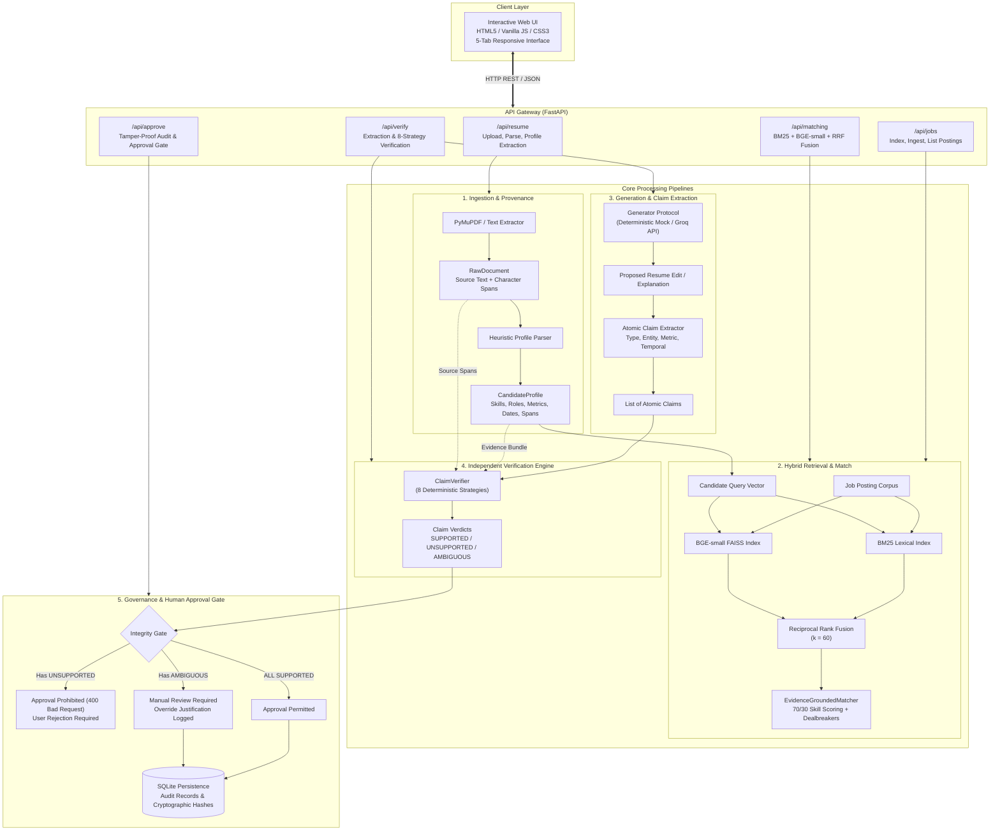
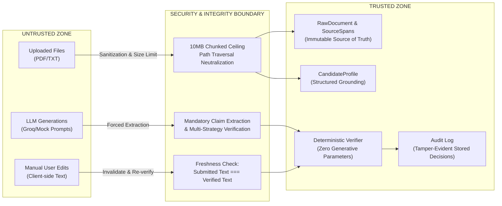
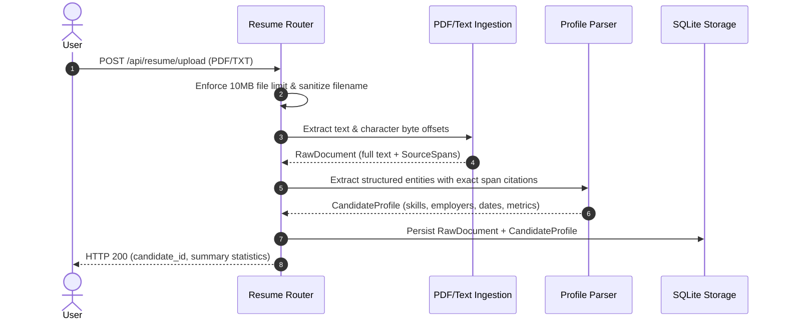
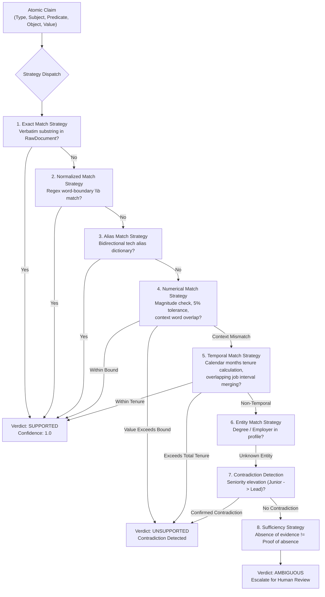
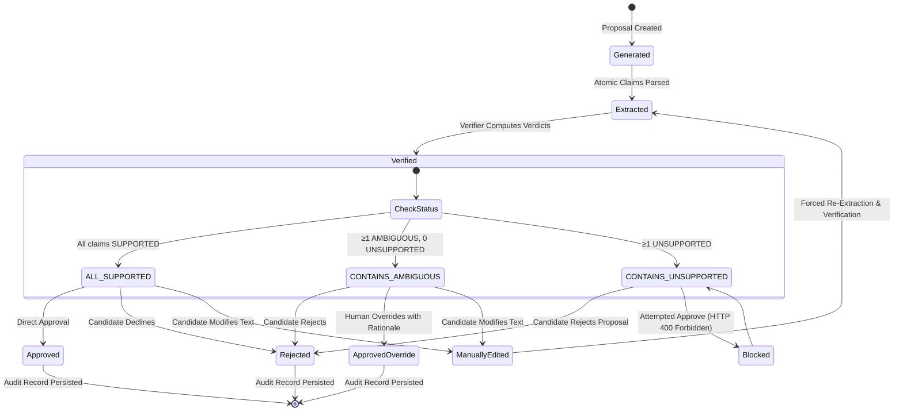

# Architecture & System Design — NeverInvent

**Tagline:** Verify AI-generated claims. Stop fabricated resume information.  
**System Version:** NeverInvent v1.0 (Research Prototype)

---

## 1. Core Architectural Principle

> **Fundamental Invariant:**  
> The claim verification engine must be strictly decoupled from the text generation model.  
> The generator may propose text; it must **never** decide whether its own claims are true.

This separation is not an implementation preference—it is the foundational research requirement. In an LLM-based workflow, self-verification suffers from autoregressive confirmation bias. By enforcing a deterministic, rule-grounded verifier with zero LLM dependencies, NeverInvent achieves reproducible, auditable, sub-millisecond factual verification with zero hallucination.

---

## 2. System Architecture Overview

---

## 3. Trust Boundary Analysis

NeverInvent operates with strict trust boundaries to prevent fabricated claims from leaking into verified records:

### Trust Boundary Invariants:
1. **Generative LLM is Untrusted:** No output from an LLM is ever written to verified storage or presented as verified fact without passing through the independent claim verifier.
2. **User Input is Untrusted:** Any manual edits made to a proposed bullet immediately invalidate prior verification tokens. The backend rejects stale verification IDs and requires re-extracting and re-verifying the edited text.
3. **Source Evidence is Immutable:** The `RawDocument` and extracted `CandidateProfile` created upon resume upload serve as the read-only grounding baseline.

---

## 4. Ingestion & Provenance Architecture

Every extracted datum in `CandidateProfile` maintains:
- `original_text`: Verbatim string as it appeared in the resume.
- `source_span`: Tuple `(char_start, char_end, page_number)`.
- `normalized_value`: Standardized representation (lowercase, ISO date, float metric).

---

## 5. Claim Verification Pipeline

---

## 6. Approval & Governance State Machine

---

## 7. Module Directory Structure & Responsibilities

| Directory | Core Responsibility | Key Invariants |
|---|---|---|
| `neverinvent/ingestion/` | Raw text and span extraction from PDF/TXT documents. | Never modifies source content; records character spans for every token. |
| `neverinvent/parsing/` | Converts raw text into structured `CandidateProfile`. | Never guesses or fabricates missing fields; leaves unknown values as `None`. |
| `neverinvent/retrieval/` | Lexical (BM25), Dense (BGE-small), and Hybrid (RRF) search. | Decoupled from verification; retrieval score does not constitute factual proof. |
| `neverinvent/matching/` | Evaluates candidate fit against job requirements. | 70/30 required vs preferred skill weighting; dealbreaker enforcement. |
| `neverinvent/generation/` | Pluggable text generator (Mock / Groq LLM API). | Generates unverified proposals; completely isolated from verifier. |
| `neverinvent/claims/` | Extracts atomic factual claims from generated text. | Rule-based extraction; does not assign verdicts. |
| `neverinvent/verification/` | 8-strategy deterministic verification engine. | Zero LLM calls; sub-millisecond latency; outputs SUPPORTED/UNSUPPORTED/AMBIGUOUS. |
| `neverinvent/workflow/` | Proposal lifecycle, review states, and audit tracking. | Strictly enforces approval gates and prevents duplicate or stale approvals. |
| `neverinvent/persistence/` | SQLAlchemy models and SQLite storage layer. | Relational integrity for profiles, jobs, proposals, and audit records. |
| `neverinvent/api/` | Thin FastAPI router exposing typed REST endpoints. | Pydantic request/response validation; 10MB payload ceiling; CORS protection. |
| `frontend/` | Vanilla JS, HTML5, CSS3 user interface. | Zero external framework dependencies; clean 5-tab responsive workflow. |
| `neverinvent/evaluation/` | Empirical benchmarks for retrieval and claim verification. | Reproducible evaluation suites with zero hardcoded results. |

---

## 8. Key Architectural Decisions (ADR Summary)

| Decision | Alternative Considered | Justification |
|---|---|---|
| **Deterministic Verifier** | LLM-as-a-Judge | LLM-as-a-judge is non-deterministic, hallucinates, suffers from prompt drift, adds $1000\times$ latency (~1500ms vs 0.56ms), and incurs API cost. Deterministic rules are audit-traceable and fast. |
| **Three-Class Taxonomy** | Binary (True / False) | Real resumes contain incomplete, paraphrased, or unprovable claims. Forcing binary classification leads to high False Block Rates on legitimate candidates. `AMBIGUOUS` safely escalates to human review. |
| **Calendar Months Merging** | Simple Year/Month Subtraction | Concurrent employment across multiple roles artificially inflates total tenure if durations are summed naively. Interval merging computes true calendar experience. |
| **Reciprocal Rank Fusion** | Linear Score Combination | RRF ($k=60$) does not require score normalization across disparate scales (BM25 unbounded vs cosine $[-1, 1]$) and exhibits superior ranking robustness. |
| **Vanilla Frontend** | React / Next.js / Vue | Avoids multi-gigabyte node_modules and complex build toolchains. The project focus is Applied AI research and verification systems engineering. |
| **SQLite + SQLAlchemy** | PostgreSQL / Microservices | Zero external infrastructure overhead; fully self-contained repository; instantaneous setup for peer review and interview demonstration. |
