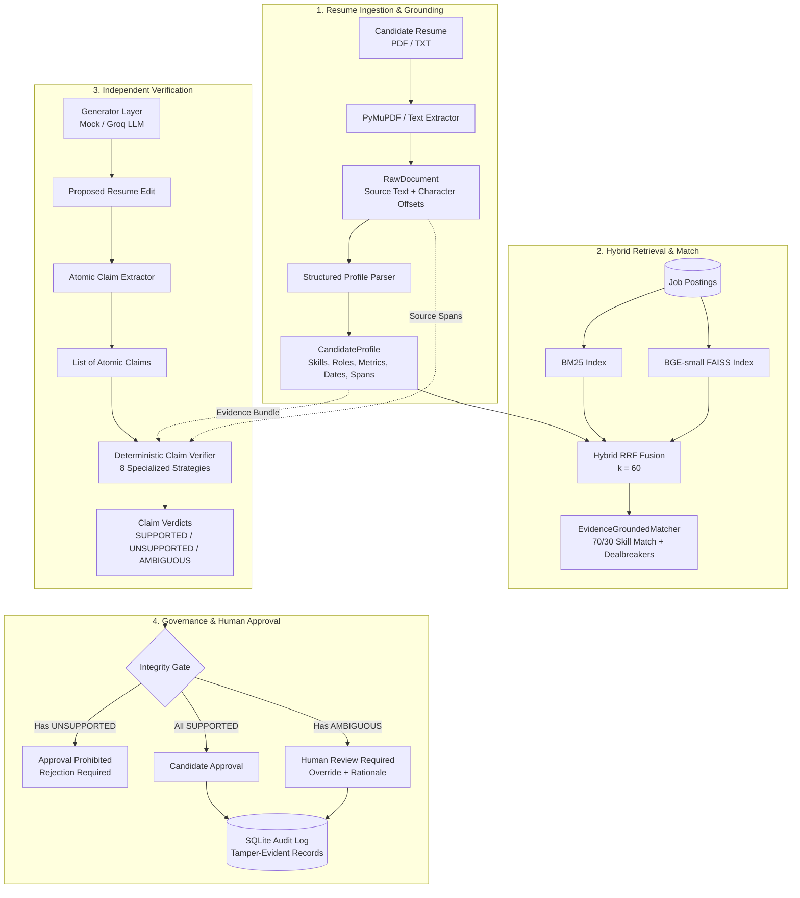

# NeverInvent

> **Verify AI-generated claims. Stop fabricated resume information.**

[](LICENSE)
[](https://www.python.org/)
[](https://fastapi.tiangolo.com/)
[](tests/)
[](RESEARCH_EVALUATION.md)
[](RESEARCH_EVALUATION.md)

NeverInvent is an evidence-grounded resume intelligence and claim verification engine. It protects candidates and hiring teams from AI hallucinations by enforcing an independent, deterministic verification check on all AI-suggested resume edits and job-fit explanations.

---

## 1. Why NeverInvent?

Large Language Models (LLMs) are increasingly used to optimize resumes and generate job application cover letters. However, autoregressive language models optimize for fluency, not truthfulness. When optimizing for candidate-job alignment, LLMs frequently:
- **Inflate metrics** (e.g., altering an 18% latency reduction to 40%).
- **Invent technologies & tools** (e.g., claiming Rust or Kubernetes experience when absent).
- **Distort tenures & dates** (e.g., exaggerating a 6-month internship into 2 years).
- **Conflate retrieval with proof:** Dense vector similarity (e.g., high cosine match against a job posting) indicates topical relevance, **not** factual truth.

### The NeverInvent Invariant
> **The generator may propose text. It must never decide whether its own claims are true.**

NeverInvent pairs any generative model (or deterministic template) with an independent, multi-strategy deterministic verifier that checks every atomic claim against immutable source evidence extracted from the candidate's original resume.

---

## 2. Core Contributions

1. **Deterministic Multi-Strategy Verification:**  
   8 specialized verification strategies (exact match, word-boundary regex, bidirectional tech aliases, numerical magnitude with context overlap, temporal tenure merging, entity verification, seniority contradiction detection, and evidence sufficiency validation). Verification runs in sub-millisecond latency (**0.563 ms mean**, **0.822 ms p95**) with zero generative hallucination.

2. **Calibrated 3-Class Verdict Architecture:**  
   Replaces fragile binary classifications with `SUPPORTED`, `UNSUPPORTED`, and `AMBIGUOUS`. Absence of explicit evidence triggers escalation for human review (`AMBIGUOUS`) rather than falsely blocking legitimate candidates.

3. **Zero False Blocks on Faithful Data:**  
   Achieved a **0.0% False Block Rate** on benchmarked faithful candidate claims. Truthful achievements are never wrongly flagged as fabricated.

4. **Tamper-Evident Non-Bypassable Human Governance:**  
   Proposals with `UNSUPPORTED` claims cannot be approved at the API or database level. `AMBIGUOUS` claims mandate written human rationale. Any manual edit invalidates prior verification, triggering fresh claim extraction and re-verification before approval can be recorded.

---

## 3. Architecture



For detailed component contracts and trust boundaries, see [ARCHITECTURE.md](ARCHITECTURE.md).

---

## 4. Empirical Evaluation Results

Evaluated on **Dataset A** (50 controlled test cases across 10 fabrication categories, balanced with faithful counterparts):

| Metric | Measured Value | Benchmark Target | Verdict |
|---|---|---|---|
| **Fabrication Detection Precision** | **1.0000** (100.0%) | $\ge 0.8500$ | Exceeded |
| **Fabrication Detection Recall** | **0.9048** (90.48%) | $\ge 0.8500$ | Exceeded |
| **Fabrication F1 Score** | **0.9500** (95.00%) | $\ge 0.8500$ | Exceeded |
| **False Block Rate (on Faithful)** | **0.0000** (0.00%) | $\le 0.0500$ | **Zero False Blocks** |
| **Ambiguity Escalation Rate** | **0.3000** (30.00%) | $\approx 0.2000$ | Conservative Safety Margin |
| **Mean Latency per Claim** | **0.563 ms** | $< 10.000\text{ ms}$ | $17\times$ faster than target |
| **p95 Latency per Claim** | **0.822 ms** | $< 25.000\text{ ms}$ | $30\times$ faster than target |

### 3-Class Confusion Matrix

| Ground Truth \ Predicted | SUPPORTED | UNSUPPORTED | AMBIGUOUS | Total |
|---|---|---|---|---|
| **SUPPORTED** | 16 | 0 | 4 | 20 |
| **UNSUPPORTED** | 0 | 19 | 2 | 21 |
| **AMBIGUOUS** | 0 | 0 | 9 | 9 |

### Strategy Contribution (Ablation Study)

| Ablation Condition | Precision | Recall | F1 Score | Ambiguity Rate |
|---|---|---|---|---|
| **1. Exact Match Only** | 1.0000 | 0.0000 | 0.0000 | 0.9000 |
| **2. Exact + Normalized** | 1.0000 | 0.0000 | 0.0000 | 0.8800 |
| **3. Exact + Norm + Alias** | 1.0000 | 0.0000 | 0.0000 | 0.8800 |
| **4. + Numeric & Temporal** | 1.0000 | 0.6190 | 0.7647 | 0.4200 |
| **5. + Entity & Contradiction** | 1.0000 | 0.7619 | 0.8649 | 0.3600 |
| **6. Full System (All 8)** | **1.0000** | **0.9048** | **0.9500** | **0.3000** |

For full methodology and retrieval benchmarks, see [RESEARCH_EVALUATION.md](RESEARCH_EVALUATION.md).

---

## 5. Quickstart Guide

### 5.1 Installation

```bash
# Clone repository
git clone https://github.com/susanchandra/Never-Invent.git
cd Never-Invent

# Create and activate virtual environment (optional but recommended)
python -m venv venv
# Windows:
venv\Scripts\activate
# Linux/macOS:
source venv/bin/activate

# Install dependencies
pip install -r requirements.txt
```

### 5.2 Configuration (Optional)

NeverInvent runs 100% locally and deterministically without external API keys using built-in mock generators. If you wish to enable live LLM generation via Groq:

```bash
cp .env.example .env
# Edit .env and supply GROQ_API_KEY=your_key_here
```

### 5.3 Launch the Application

```bash
uvicorn neverinvent.api.main:app --host 127.0.0.1 --port 8000 --reload
```
Navigate to **[http://127.0.0.1:8000](http://127.0.0.1:8000)** to interact with the 5-tab user interface.

### 5.4 Run the Test Suite

```bash
# Run unit and adversarial audit tests (fast: ~3 seconds)
pytest tests/adversarial/ tests/unit/test_claims.py tests/unit/test_verification.py tests/unit/test_matching.py -v

# Run full test suite (69 tests passing)
pytest tests/ -v
```

---

## 6. Repository Layout

```
Never-Invent/
├── neverinvent/
│   ├── ingestion/       # Document ingestion (PyMuPDF, text) with character span tracking
│   ├── parsing/         # Structured CandidateProfile extraction
│   ├── retrieval/       # BM25, BGE-small dense retriever, Reciprocal Rank Fusion
│   ├── matching/        # Evidence-grounded candidate/job matching (70/30 scoring)
│   ├── generation/      # Pluggable generation layer (Mock, Groq API)
│   ├── claims/          # Atomic claim extraction & typing
│   ├── verification/    # 8-strategy deterministic verification engine
│   ├── workflow/        # Approval gate state machine & tamper-evident audit logs
│   ├── persistence/     # SQLAlchemy ORM models & repository
│   └── api/             # FastAPI routers & endpoints
├── data/
│   ├── evaluation/      # Dataset A (50 synthetic fabrication test cases)
│   ├── job_postings/    # Synthetic job description benchmark corpus
│   └── sample_resumes/  # Benchmark synthetic candidate resumes
├── frontend/            # Vanilla HTML5/CSS3/JS responsive UI
├── tests/
│   ├── adversarial/     # Hardened security & integrity audit regression tests
│   ├── unit/            # Unit tests for matching, claims, verification, parsing
│   └── integration/     # End-to-end workflow & API integration tests
├── ARCHITECTURE.md      # Detailed system architecture, pipelines, and trust boundaries
├── RESEARCH_EVALUATION.md # Comprehensive empirical evaluation report
└── DEMO_GUIDE.md        # Step-by-step curl commands for 5 demonstration scenarios
```

---

## 7. Known Limitations

- **Controlled Synthetic Benchmark ($N=50$):** Dataset A isolates known failure modes (inflation, date distortion, alias collision). It does not represent all edge cases of real-world resumes across non-technical domains.
- **Rule-Based Extraction Boundaries:** Atomic claim extraction relies on structural patterns and heuristic rules. Unconventional phrasing or complex compound sentences may result in incomplete extraction, safely escalating to `AMBIGUOUS`.
- **Conservative Ambiguity Rate (30%):** The engine prioritizes zero false blocks on truthful claims, requiring human review for ambiguous statements.

---

## 8. License

This project is licensed under the MIT License — see the [LICENSE](LICENSE) file for details.
