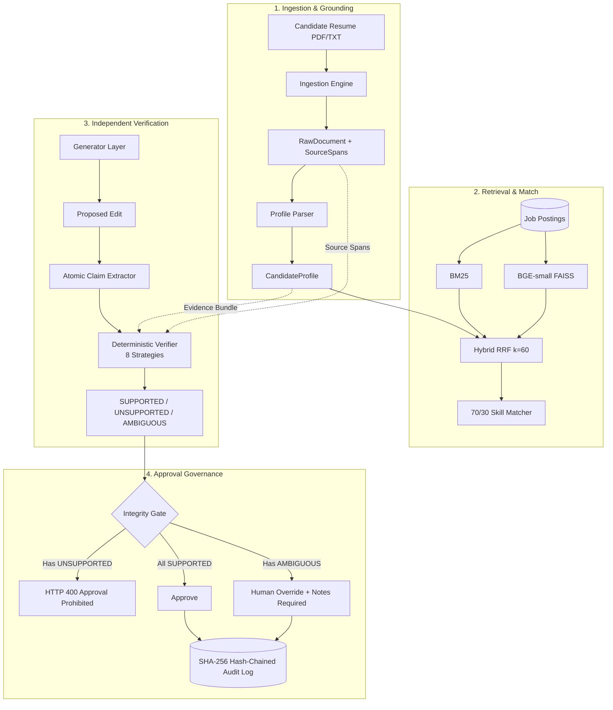

# NeverInvent

> **Verify AI-generated claims. Stop fabricated resume information.**

[](LICENSE)
[](https://www.python.org/)
[](https://fastapi.tiangolo.com/)
[](tests/)
[](.github/workflows/ci.yml)

NeverInvent is a **research prototype** demonstrating evidence-grounded factual verification of AI-generated resume text. It enforces an architectural separation: a generative layer proposes resume edits, and an independent deterministic engine verifies every atomic factual claim against the candidate's original resume evidence.

This is a portfolio research project, not a production recruitment tool.

---

## 1. The Research Problem

LLMs generate plausible-sounding resume text that may fabricate or distort facts: inflating metrics (18% → 40%), inventing skills, stretching tenures, or elevating job titles. Retrieval similarity between a resume and a job posting indicates topical relevance — it does **not** prove any factual claim true. NeverInvent separates these concerns architecturally.

---

## 2. Core Research Contributions

1. **Independent deterministic multi-strategy verifier** — 8 specialized strategies (exact match, regex word-boundary, bidirectional tech aliases, numerical magnitude checking with context overlap, calendar-month tenure merging, entity verification, seniority contradiction, evidence sufficiency). Runs in under 1 ms per claim.

2. **Calibrated 3-class verdict taxonomy** — `SUPPORTED`, `UNSUPPORTED`, and `AMBIGUOUS`. Absence of evidence escalates to `AMBIGUOUS` for human review; `UNSUPPORTED` is only returned on positive contradiction.

3. **Non-bypassable human approval gate** — proposals with `UNSUPPORTED` claims are blocked at the API and DB layer. Manual edits invalidate prior verification tokens, requiring fresh claim extraction and re-verification.

4. **SHA-256 hash-chained audit log** — every approval or rejection is recorded in a cryptographically linked ledger; payload tampering, deletion, and reordering are detectable.

---

## 3. Architecture



---

## 4. Empirical Evaluation Results

### Important Disclaimers

> **Dataset A** (50 cases) is a **controlled diagnostic** dataset built to test specific, known fabrication patterns. It was not held out independently before system development; treat these numbers as development-set diagnostics, not test-set generalization estimates.

> **Dataset B** (100 cases) is a **natural benchmark** frozen prior to evaluation, with zero verifier rules tuned against it. It provides a more realistic picture of system behavior. All metrics include sample sizes ($N$) for interpretability.

> **Retrieval results** are based on 5 candidate queries against 10 job postings. Annotated by a single reviewer. Near-ceiling nDCG@10 at this scale reflects ranking correctness over a small corpus, not production-scale IR superiority.

> **Groq LLM-as-judge baseline**: Not executed. `GROQ_API_KEY` was not configured during evaluation. If configured, run `python -m neverinvent.evaluation.dataset_b_eval --judge groq` to execute the comparison. Results must not be inferred from this report.

### 4.1 Dataset A — Controlled Diagnostic (50 cases, single annotator, development set)

| Metric | Value | Sample ($N$) | Note |
|---|---|---|---|
| Fabrication Detection Precision | **1.0000** | 29 predicted UNSUPPORTED | No false UNSUPPORTED verdicts |
| Fabrication Detection Recall | **0.9048** | $N=21$ true UNSUPPORTED | 2/21 routed to AMBIGUOUS |
| Fabrication F1 | **0.9500** | $N=50$ total | — |
| False Block Rate on Faithful | **0.0000** | $N=20$ faithful | 0/20 marked UNSUPPORTED |
| Faithful Routed to AMBIGUOUS | **0.2000** (20%) | $N=20$ faithful | 4/20 safe human escalation |
| Ambiguity Rate | **0.3000** | $N=50$ total | — |
| Mean Latency / Claim | **0.563 ms** | $N=50$ | CPU-only |
| p95 Latency / Claim | **0.822 ms** | $N=50$ | CPU-only |

> **Ablation note:** Exact-match, normalized-match, and alias-match stages alone achieve 0% fabrication recall (0/21 UNSUPPORTED claims detected) because fabrications alter numbers, dates, or phrasings. These stages cannot establish `UNSUPPORTED` verdicts — they only provide `SUPPORTED` matches or pass through to later strategies.

### 4.2 Dataset B — Natural Benchmark (100 cases, single annotator, held-out evaluation set)

| Class | Precision | Recall | F1 | Support ($N$) |
|---|---|---|---|---|
| SUPPORTED | 0.9714 | 0.8500 | 0.9067 | 40 |
| UNSUPPORTED | 0.8636 | 0.4750 | 0.6129 | 40 |
| AMBIGUOUS | 0.3953 | 0.8500 | 0.5397 | 20 |
| **Macro Avg** | **0.7434** | **0.7250** | **0.6864** | **100** |

**Safety metrics (Dataset B):**
- False Unsupported on Faithful: **0/40 (0.0%)** — no faithful claims wrongly blocked
- Fabrication Recall: **47.5%** — 21/40 fabrications caught; 20/40 routed to AMBIGUOUS, 1/40 false approval
- Ambiguity Rate: **43%** — high human review burden on natural, paraphrased text

**Key finding:** On natural, paraphrased claims, 20/40 fabrications are routed to `AMBIGUOUS` rather than definitively `UNSUPPORTED`. This is correct conservative behavior — the system avoids false `SUPPORTED` verdicts — but it means 43% of claims require human review. The overall human-review burden is substantial in a production deployment.

### 4.3 Retrieval (5 queries, 10 job postings, single annotator)

| Retriever | Precision@5 | Recall@10 | MRR | nDCG@10 |
|---|---|---|---|---|
| BM25 | 0.60 | 1.00 | 1.00 | 0.9725 |
| Dense (bge-small-en-v1.5) | 0.64 | 1.00 | 1.00 | 0.9867 |
| Hybrid (RRF k=60) | 0.64 | 1.00 | 1.00 | 0.9866 |

> Near-ceiling metrics reflect the small corpus size (10 jobs). These numbers demonstrate correct ranking logic and hybrid fusion behavior, not general retrieval superiority.

---

## 5. Quickstart

```bash
git clone https://github.com/susanchandra/Never-Invent.git
cd Never-Invent

pip install -r requirements.txt

# Optional: configure Groq for LLM generation (not needed for mock/deterministic mode)
cp .env.example .env
# edit .env and set GROQ_API_KEY=your_key_here

uvicorn neverinvent.api.main:app --host 127.0.0.1 --port 8000 --reload
```

Navigate to [http://127.0.0.1:8000](http://127.0.0.1:8000).

### Run Tests

```bash
# Fast suite (~5 seconds, no model download):
pytest tests/adversarial/ tests/unit/test_audit_integrity.py tests/unit/test_matching.py \
       tests/unit/test_claims.py tests/unit/test_verification.py tests/unit/test_dataset_b.py \
       tests/unit/test_persistence.py -v

# Full suite (~100 seconds, downloads BGE-small model on first run):
pytest tests/ -v
```

### Reproduce Evaluation Results

```bash
# Dataset A (controlled diagnostic, 50 cases)
python -m neverinvent.evaluation.verification_eval

# Dataset B (natural benchmark, 100 cases)
python -m neverinvent.evaluation.dataset_b_eval

# Retrieval benchmark (5 queries, 10 job postings)
python -m neverinvent.evaluation.retrieval_eval
```

---

## 6. Known Limitations

1. **Dataset A is a development set, not an independent test set.** The 50 cases were designed to cover known failure modes and cannot be used to claim generalization performance.

2. **Dataset B is annotated by a single evaluator.** No inter-annotator agreement is available. Single-annotator labels introduce subjective judgment, particularly for AMBIGUOUS cases.

3. **High ambiguity rate on natural text (43%).** The verifier conservatively routes uncertain claims to AMBIGUOUS rather than risk false `UNSUPPORTED` verdicts. In production this means substantial human review overhead.

4. **LLM-as-judge baseline not executed.** No GROQ_API_KEY was available. The comparison between deterministic verifier and LLM judge is not reported.

5. **Rule-based claim extraction** may miss claims in non-standard sentence structures, increasing false-negative fabrication detection rates.

6. **Retrieval evaluation at small corpus scale (10 jobs, 5 queries).** Near-ceiling nDCG@10 reflects correct behavior at this scale, not production IR performance.

7. **Hash chain integrity limitation.** The SHA-256 hash chain detects payload tampering, record deletion, and reordering via chain verification. It does **not** prevent full-chain rewriting by an attacker with direct database write access — it only makes such manipulation detectable during the next verification call.

---

## 7. Repository Layout

```
Never-Invent/
├── neverinvent/
│   ├── ingestion/       # PDF/TXT ingestion with character span provenance
│   ├── parsing/         # CandidateProfile extraction
│   ├── retrieval/       # BM25, BGE-small dense, hybrid RRF
│   ├── matching/        # 70/30 evidence-grounded skill matching
│   ├── generation/      # Pluggable generator (Mock / Groq)
│   ├── claims/          # Atomic claim extractor
│   ├── verification/    # 8-strategy deterministic verifier
│   ├── workflow/        # Approval gate state machine
│   ├── persistence/     # SQLAlchemy ORM + SHA-256 audit chain
│   └── api/             # FastAPI routers
├── data/
│   ├── evaluation/      # Dataset A (50-case diagnostic) + Dataset B (100-case natural)
│   ├── job_postings/    # 10 synthetic job postings
│   └── sample_resumes/  # Synthetic benchmark resume
├── frontend/            # Vanilla HTML5/CSS3/JS UI
├── tests/
│   ├── adversarial/     # Security and integrity regression tests
│   ├── unit/            # Unit + Dataset B + audit integrity tests
│   └── integration/     # End-to-end workflow test
├── .github/workflows/   # CI configuration (fast tests, no paid APIs)
├── ARCHITECTURE.md      # System architecture with Mermaid diagrams
├── RESEARCH_EVALUATION.md # Full methodology and results
└── DEMO_GUIDE.md        # Five tested demonstration scenarios
```

---

## 8. License

MIT License — see [LICENSE](LICENSE).
