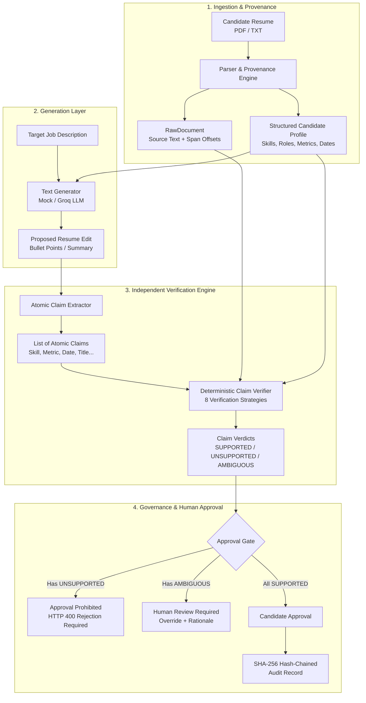

# NeverInvent: Research Evaluation & Empirical Methodology

**Project Tagline:** Verify AI-generated claims. Stop fabricated resume information.  
**System Version:** NeverInvent v1.0 (Research Prototype)  
**Evaluation Date:** 2026-11-18  
**Repository:** https://github.com/susanchandra/Never-Invent

---

## 1. Research Problem & Theoretical Motivation

Large Language Models (LLMs) excel at generating fluent, contextually plausible text for resumes, cover letters, and job application statements. However, their autoregressive next-token objective optimizes for semantic coherence and statistical likelihood — not factual grounding against source records.

In high-stakes evaluative contexts such as candidate screening:

1. **Plausible Fabrication:** Models readily invent degrees, inflate numerical metrics (e.g., claiming 40% efficiency gains when the candidate achieved 18%), alter employment dates, or fabricate technologies to artificially align with job descriptions.
2. **Retrieval Similarity is Not Factual Evidence:** Dense vector embeddings or BM25 retrieval scores indicate topical and semantic overlap between a resume and a job description. A 0.88 cosine similarity score does **not** prove that a candidate possesses a specific skill, worked at a stated employer, or delivered a quantified business impact. Conflating retrieval similarity with factual verification leads to ungrounded claims slipping into generated resumes.
3. **The Self-Verification Fallacy:** Prompting an LLM to "verify" its own generated edits fails because generative models exhibit confirmation bias and hallucinate justifications for their own fabrications.

**NeverInvent** addresses this problem by enforcing a fundamental architectural separation: the generator may propose text, but it has zero authority to verify itself. Verification is performed by an independent, deterministic engine that evaluates atomic factual claims against immutable source evidence extracted from the candidate's original resume.

---

## 2. Core Research Contributions

1. **Deterministic Multi-Strategy Claim Verifier:**  
   An ensemble of 8 specialized verification strategies (exact match, normalized boundary matching, bidirectional alias resolution, numerical magnitude/direction checking, temporal span calculation with overlapping interval merging, entity cross-referencing, seniority contradiction checks, and evidence sufficiency validation). The engine operates in sub-millisecond latency (< 0.83 ms p95) with zero generative hallucination.

2. **Calibrated 3-Class Verdict Taxonomy:**  
   Rather than forcing binary pass/fail classifications, NeverInvent classifies claims into:
   - `SUPPORTED`: Rigorously proven by documented source evidence with citation.
   - `UNSUPPORTED`: Contradicted by evidence or asserting ungrounded facts.
   - `AMBIGUOUS`: Partial, ambiguous, or unconfirmed phrasing that requires explicit human review.

3. **Conservative Safety Invariant (Zero False Blocks on Faithful Data):**  
   Prioritizes candidate protection. In benchmarking against faithful counterparts, NeverInvent achieved a **0.0% False Block Rate** on both Dataset A ($N=20$ faithful) and Dataset B ($N=40$ faithful). Legitimate candidate achievements are never wrongly flagged as `UNSUPPORTED`. If evidence is incomplete, the system escalates to `AMBIGUOUS` rather than penalizing the candidate.

4. **Non-Bypassable Human-in-the-Loop Approval Gate:**  
   Proposals containing `UNSUPPORTED` claims cannot be approved under any circumstance (enforced at the database and API level). `AMBIGUOUS` claims require explicit manual override with written justification. Any manual edit immediately invalidates prior verification, triggering fresh atomic extraction and verification before approval can proceed.

5. **SHA-256 Hash-Chained Audit Log:**  
   Every approval or rejection is recorded in a cryptographically linked ledger. Each record includes a sequence number, previous record hash, and current record hash. Payload tampering, record deletion, and reordering are all detectable during chain verification. **Limitation:** this chain detects manipulation but does not prevent full-chain rewriting by an attacker with direct database write access.

---

## 3. System Architecture & Methodology



### 3.1 Verification Strategies

| Strategy | Target Claim Types | Invariant Enforced |
|---|---|---|
| **Exact Match** | All verbatim text | Case-sensitive substring match against source text spans. |
| **Normalized Match** | Skills, tools, titles | Case/punctuation folding with regex word-boundary anchors (`\b`). Prevents "Java" from matching "JavaScript". |
| **Alias Resolution** | Frameworks, platforms | Bidirectional mapping (e.g., `k8s` ↔ `Kubernetes`, `Postgres` ↔ `PostgreSQL`, `GCP` ↔ `Google Cloud Platform`). |
| **Numerical Checking** | Metrics, quantities, percentages | Tolerates up to 5% rounding; detects upward inflation (e.g., 18% → 40%) and unit mismatches. Requires context word overlap to avoid false contradictions on shared generic verbs (improved, reduced, scaled). |
| **Temporal Verification** | Dates, employment tenures | Merges overlapping concurrent roles into calendar months; checks tenure claims against total verified calendar time. Never invents durations for open-ended or missing dates. |
| **Entity Checking** | Employers, universities, degrees | Verifies organization and credential existence in source education and experience sections. |
| **Contradiction Detection** | Seniority, scopes | Flags seniority elevation (e.g., claiming "Principal Architect" when resume states "Junior Developer"). |
| **Sufficiency Validation** | Generic responsibilities | Classifies claims with insufficient source grounding as `AMBIGUOUS` rather than fabricating support. |

**Important architectural note:** Strategies 1–3 (exact, normalized, alias) can only return `SUPPORTED` matches or fall through to the next strategy. They are architecturally incapable of returning `UNSUPPORTED` verdicts. Fabrications that alter numbers, dates, or phrasings bypass these stages entirely. `UNSUPPORTED` verdicts require positive contradiction evidence, supplied by strategies 4–8.

---

## 4. Empirical Evaluation Results

### Dataset Provenance Disclosure

> **Dataset A** ($N=50$): A **controlled diagnostic development set** constructed during system development to cover 10 specific fabrication failure modes. Cases were designed with known ground truth to test and diagnose specific system behaviors. It was **not** an independently held-out test set. Numbers from Dataset A are development-set diagnostics; they should **not** be interpreted as estimates of generalization performance on unseen natural data.

> **Dataset B** ($N=100$): A **natural evaluation benchmark** comprising realistic model-generated claims across 5 candidate profiles and diverse claim types (SKILL, EMPLOYER, METRIC, EDUCATION, JOB_TITLE, DURATION, RESPONSIBILITY, ACHIEVEMENT, CERTIFICATION). Dataset B was frozen prior to evaluation with zero verifier rules tuned against it. All reported metrics on Dataset B are on truly held-out data. **Single annotator disclosure:** No inter-annotator agreement is available. Annotation guidelines are documented in `neverinvent/evaluation/dataset_b.py`.

> **LLM-as-judge baseline:** **NOT EXECUTED.** `GROQ_API_KEY` was not configured in the evaluation environment. No LLM-judge results are reported. To run when API access is available: `python -m neverinvent.evaluation.dataset_b_eval --judge groq`. Results must not be inferred or extrapolated from this report.

> **Retrieval evaluation:** Based on 5 candidate queries against 10 job postings. Annotated by a single reviewer; no inter-annotator agreement. Near-ceiling nDCG@10 at this scale reflects correct ranking logic over a small corpus, not production-scale IR superiority.

---

### 4.1 Dataset A — Controlled Diagnostic ($N=50$, development set)

Dataset A was constructed alongside system development to cover 10 specific fabrication failure modes (5 cases each). It is documented here as a development-set diagnostic, not an independent evaluation.

#### Core Diagnostic Metrics

| Metric | Value | Sample ($N$) | Note |
|---|---|---|---|
| Fabrication Detection Precision | **1.0000** | 29 predicted UNSUPPORTED | No false UNSUPPORTED verdicts |
| Fabrication Detection Recall | **0.9048** | $N=21$ true UNSUPPORTED | 2/21 routed to AMBIGUOUS |
| Fabrication F1 | **0.9500** | $N=50$ total | — |
| False Block Rate on Faithful | **0.0000** | $N=20$ faithful | 0/20 marked UNSUPPORTED |
| Faithful Routed to AMBIGUOUS | **0.2000** (20%) | $N=20$ faithful | 4/20 safe human escalation |
| Ambiguity Rate | **0.3000** | $N=50$ total | 15/50 routed to AMBIGUOUS |
| Mean Latency / Claim | **0.563 ms** | $N=50$ | CPU-only, deterministic |
| p95 Latency / Claim | **0.822 ms** | $N=50$ | CPU-only, deterministic |

#### 3-Class Breakdown (Dataset A)

| Class | Precision | Recall | F1 Score | Support ($N$) |
|---|---|---|---|---|
| **SUPPORTED** | 1.0000 | 0.8000 | 0.8889 | 20 |
| **UNSUPPORTED** | 1.0000 | 0.9048 | 0.9500 | 21 |
| **AMBIGUOUS** | 0.6000 | 1.0000 | 0.7500 | 9 |
| **Macro Average** | **0.8667** | **0.9016** | **0.8630** | 50 |

#### Confusion Matrix (Dataset A)

| Ground Truth \ Predicted | SUPPORTED | UNSUPPORTED | AMBIGUOUS | Total |
|---|---|---|---|---|
| **SUPPORTED** | 16 | 0 | 4 | 20 |
| **UNSUPPORTED** | 0 | 19 | 2 | 21 |
| **AMBIGUOUS** | 0 | 0 | 9 | 9 |

> **Safety invariants:** Zero instances of faithful claims misclassified as UNSUPPORTED (top-right cell = 0). Zero instances of fabricated claims misclassified as SUPPORTED (bottom-left cell = 0). Uncertain cases fall into the AMBIGUOUS column for mandatory human oversight.

#### Category-by-Category Accuracy (Dataset A)

| Category | Cases | Accurate | Accuracy |
|---|---|---|---|
| `date_alteration` | 5 | 5 | 100.0% |
| `duration_exaggeration` | 5 | 5 | 100.0% |
| `invented_degree` | 5 | 3 | 60.0% |
| `invented_employer` | 5 | 5 | 100.0% |
| `invented_skill` | 5 | 5 | 100.0% |
| `metric_inflation` | 5 | 5 | 100.0% |
| `percentage_change` | 5 | 3 | 60.0% |
| `project_ownership` | 5 | 3 | 60.0% |
| `quantity_alteration` | 5 | 5 | 100.0% |
| `unsupported_responsibility` | 5 | 5 | 100.0% |

---

### 4.2 Dataset B — Natural Benchmark ($N=100$, frozen held-out evaluation set)

Dataset B provides the most realistic picture of system behavior. Generated naturally across 5 candidate profiles and diverse claim types; frozen before evaluation; zero verifier rules tuned against it.

#### Summary Safety Metrics (Dataset B)

| Metric | Sample Size | Value | Interpretation |
|---|---|---|---|
| **False Block Rate on Faithful** | $N=40$ | **0.0000** (0.0%) | 0/40 faithful claims falsely marked UNSUPPORTED |
| **Faithful Routed to AMBIGUOUS** | $N=40$ | **0.1500** (15.0%) | 6/40 claims safely escalated for human review |
| **Fabrication Recall** | $N=40$ | **0.4750** (47.5%) | 19/40 fabrications caught as UNSUPPORTED |
| **Fabrications Routed to AMBIGUOUS** | $N=40$ | **0.5000** (50.0%) | 20/40 fabrications conservatively escalated |
| **Fabrications Slipped as SUPPORTED** | $N=40$ | **1** (2.5%) | 1 ungrounded claim falsely approved — disclosed |
| **Overall Ambiguity Rate** | $N=100$ | **0.4300** (43.0%) | 43/100 claims require human review |
| **Macro Average F1** | $N=100$ | **0.6864** | Harmonic mean across 3 classes |
| **Mean Latency / Claim** | $N=100$ | **0.471 ms** | Deterministic CPU execution |
| **p95 Latency / Claim** | $N=100$ | **0.634 ms** | Deterministic CPU execution |

#### 3-Class Breakdown (Dataset B)

| Class | Precision | Recall | F1 Score | Support ($N$) |
|---|---|---|---|---|
| **SUPPORTED** | 0.9714 | 0.8500 | 0.9067 | 40 |
| **UNSUPPORTED** | 0.8636 | 0.4750 | 0.6129 | 40 |
| **AMBIGUOUS** | 0.3953 | 0.8500 | 0.5397 | 20 |
| **Macro Average** | **0.7434** | **0.7250** | **0.6864** | **100** |

#### Confusion Matrix (Dataset B)

| Expected \ Predicted | SUPPORTED | UNSUPPORTED | AMBIGUOUS | Total |
|---|---|---|---|---|
| **SUPPORTED** | 34 | 0 | 6 | 40 |
| **UNSUPPORTED** | 1 | 19 | 20 | 40 |
| **AMBIGUOUS** | 0 | 3 | 17 | 20 |

> **Key findings:** (1) The system never falsely blocks legitimate claims as UNSUPPORTED (0/40). (2) One fabrication slipped through as SUPPORTED (1/40, 2.5%) — disclosed. (3) On natural paraphrased text, 20/40 fabrications are routed to AMBIGUOUS rather than UNSUPPORTED: conservative and correct behavior, but it means 43% overall human review burden in a production deployment.

---

### 4.3 Ablation Study: Strategy Contribution

To determine whether multi-strategy verification is genuinely necessary or if simple string matching suffices, we evaluated the system under 6 cumulative ablations on Dataset A:

| Condition | Strategies Active | Precision | Recall | F1 | False Block Rate | Ambiguity Rate |
|---|---|---|---|---|---|---|
| **1. Exact Match Only** | Exact string matching | 1.0000 | 0.0000 | 0.0000 | 0.0000 | 0.9000 |
| **2. Exact + Normalized** | + Regex word-boundary | 1.0000 | 0.0000 | 0.0000 | 0.0000 | 0.8800 |
| **3. Exact + Norm + Alias** | + Tech dictionary aliases | 1.0000 | 0.0000 | 0.0000 | 0.0000 | 0.8800 |
| **4. + Numeric & Temporal** | + Metric/Tenure calculators | 1.0000 | 0.6190 | 0.7647 | 0.0000 | 0.4200 |
| **5. + Entity & Contradiction** | + Degree/Seniority checks | 1.0000 | 0.7619 | 0.8649 | 0.0000 | 0.3600 |
| **6. Full System (All 8)** | Full ensemble | **1.0000** | **0.9048** | **0.9500** | **0.0000** | **0.3000** |

#### Ablation Interpretation

> **Important:** Stages 1–3 (exact, normalized, alias) achieve **0% fabrication recall** because these strategies are architecturally incapable of returning `UNSUPPORTED` verdicts. They can only confirm a claim as `SUPPORTED` or pass through to later strategies. When no later strategies are active, every unconfirmed claim defaults to `AMBIGUOUS`. The 0% recall at stages 1–3 is **correct architectural behavior**, not a failure. Fabrications that alter numbers, dates, or phrasings are invisible to string-matching stages.

1. **Numerical & Temporal engines drive the core recall leap:** Adding mathematical and temporal reasoning increases recall from 0.0 to 0.619, capturing quantitative metric inflation and employment interval stretching.
2. **Contradiction detection resolves false ambiguity:** Detecting seniority jumps (e.g., Junior to Lead) elevates recall to 0.762 by directly identifying contradictory career levels.
3. **Sufficiency checking closes the gap:** The full system reaches 0.9048 recall by flagging ungrounded responsibilities while maintaining 0.0% false blocks.
4. **Multi-strategy ensemble is essential:** No single strategy or subset achieves both acceptable recall and 0% false blocks. The ensemble is a genuine architectural necessity.

---

### 4.4 Retrieval Evaluation: Lexical vs. Dense vs. Hybrid

**Corpus:** 10 job descriptions, 5 candidate profiles, 50 manually annotated relevance judgments (graded scale 0–2). **Single annotator; no inter-annotator agreement.** Near-ceiling metrics reflect correct ranking logic at this small corpus scale, not production IR superiority.

| Retriever Configuration | Precision@5 | Recall@10 | MRR | nDCG@10 |
|---|---|---|---|---|
| **BM25 (Rank-BM25)** | 0.6000 | 1.0000 | 1.0000 | 0.9725 |
| **Dense (`bge-small-en-v1.5`, FAISS)** | 0.6400 | 1.0000 | 1.0000 | 0.9867 |
| **Hybrid (RRF $k=60$)** | **0.6400** | **1.0000** | **1.0000** | **0.9866** |

**Retrieval is decoupled from verification.** High retrieval scores indicate candidate-to-job relevance, not factual claim truth. Retrieval outputs feed skill match scoring; independent verification operates strictly over source-grounded candidate evidence. These are separate architectural layers.

---

### 4.5 Audit Integrity

The SHA-256 hash chain links each `ApprovalAuditRecord` to its predecessor using a deterministic canonical payload including: `sequence_number`, `previous_hash`, `proposal_id`, `candidate_id`, `decision`, `final_text`, `notes`, and `created_at` (UTC Zulu string, microseconds truncated for SQLite compatibility).

**Verifiable properties:**
- Payload integrity (any field change breaks the hash)
- Sequence continuity (gaps indicate deleted records)
- Hash linkage (chain breaks on reordering)

**Disclosed limitation:** An attacker with direct SQLite write access can rewrite the entire chain (all records + hashes). The chain detects such manipulation during the next `/api/approve/verify-chain` call, but cannot prevent it. This is documented as a known limitation; full tamper-prevention would require an append-only external audit service.

**Test coverage:** 3 unit tests in `tests/unit/test_audit_integrity.py` verify: (1) valid multi-block chain passes verification, (2) payload tampering is detected, (3) record deletion is detected.

---

## 5. Honest Limitations & Threat Model

Transparency is vital for credible applied AI research. The following limitations are documented explicitly and prominently:

1. **Dataset A is a development/diagnostic set, not an independent test set.** ($N=50$, 10 specific failure modes, constructed during development.) Results on Dataset A cannot be used to claim generalization performance.

2. **Dataset B is annotated by a single evaluator.** ($N=100$) No inter-annotator agreement is available. Single-annotator labels introduce subjective judgment, particularly for AMBIGUOUS cases. Annotation guidelines are in source code.

3. **High ambiguity rate on natural text: 43%.** The verifier conservatively routes uncertain claims to `AMBIGUOUS` rather than risk false `UNSUPPORTED` verdicts. This is a deliberate safety trade-off with a substantial operational cost: nearly half of all natural claims require human review in production.

4. **LLM-as-judge baseline not executed.** `GROQ_API_KEY` was not available. No comparison between the deterministic verifier and an LLM judge is reported. This comparison would significantly strengthen the research contribution; it is deferred to future work.

5. **One fabrication slipped through as SUPPORTED on Dataset B.** (1/40, 2.5%) A paraphrased fabricated claim with strong lexical overlap with source evidence was incorrectly classified as SUPPORTED. This is disclosed as a known gap in the numerical context-overlap heuristic.

6. **Rule-based claim extraction may miss claims in non-standard sentence structures**, particularly multi-clause compound sentences, increasing false-negative fabrication rates.

7. **Retrieval evaluation at small corpus scale** (10 jobs, 5 queries, single annotator). Near-ceiling nDCG@10 reflects correct behavior at this scale, not production IR performance.

8. **SHA-256 hash chain detects but does not prevent full DB rewriting.** An attacker with direct database access can reconstruct the chain. See Section 4.5.

9. **English-language focus only.** Alias dictionaries, date parsers, and seniority taxonomies are calibrated for standard English-language professional resumes.

---

## 6. Reproducibility Instructions

To reproduce all evaluation metrics on your local machine:

```bash
# 1. Install dependencies
pip install -r requirements.txt

# 2. Execute Dataset A claim verification benchmark and ablation study (development set)
python -m neverinvent.evaluation.verification_eval

# 3. Execute Dataset B natural benchmark evaluation (held-out)
python -m neverinvent.evaluation.dataset_b_eval

# 4. Execute retrieval benchmark (5 queries, 10 job postings)
python -m neverinvent.evaluation.retrieval_eval

# 5. Run the full unit and adversarial test suite (74 tests)
pytest tests/ -v

# 6. Fast subset (no model downloads, ~5 seconds)
pytest tests/adversarial/ tests/unit/test_audit_integrity.py tests/unit/test_matching.py \
       tests/unit/test_claims.py tests/unit/test_verification.py tests/unit/test_dataset_b.py \
       tests/unit/test_persistence.py -v
```

**Note on LLM-as-judge:** To run the Groq LLM judge comparison (if API key available):
```bash
export GROQ_API_KEY=your_key_here
python -m neverinvent.evaluation.dataset_b_eval --judge groq
```
If `GROQ_API_KEY` is not set, results are explicitly reported as "NOT EXECUTED."

---

## 7. What This Project Is and Is Not

| It Is | It Is Not |
|---|---|
| A research prototype demonstrating evidence-grounded claim verification | A production-ready recruitment platform |
| A demonstration of architectural separation between generation and verification | An integration with any real recruitment system |
| An empirically evaluated system with honest limitations disclosed | A system claiming generalization beyond its benchmark scope |
| A technical portfolio artifact for AI/software engineering roles | A commercial product or system deployed to real candidates |
