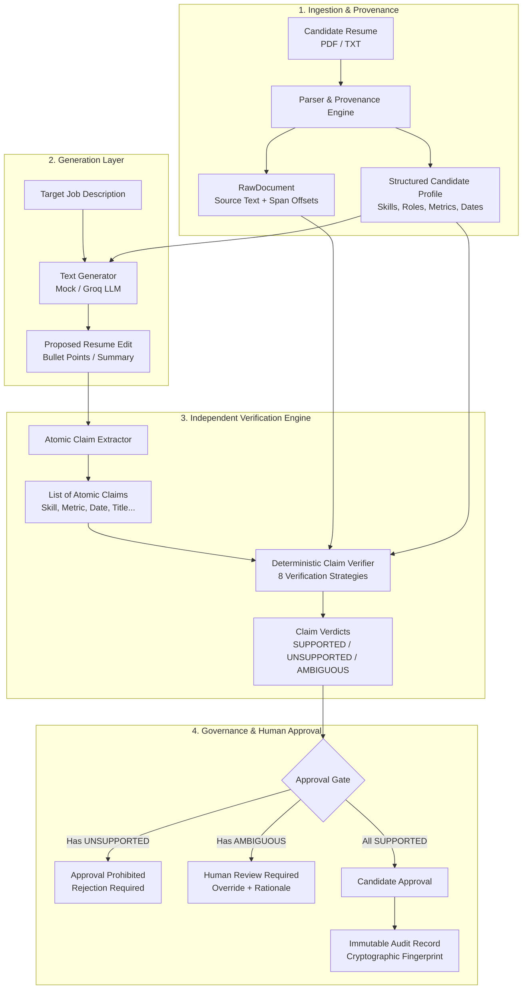

# NeverInvent: Research Evaluation & Empirical Methodology

**Project Tagline:** Verify AI-generated claims. Stop fabricated resume information.  
**System Version:** NeverInvent v1.0 (Research Prototype)  
**Evaluation Date:** 2026-11-18  

---

## 1. Research Problem & Theoretical Motivation

Large Language Models (LLMs) excel at generating fluent, contextually plausible text for resumes, cover letters, and job application statements. However, their autoregressive next-token objective optimizes for semantic coherence and statistical likelihood—not factual grounding against source records.

In high-stakes evaluative contexts such as candidate screening:
1. **Plausible Fabrication:** Models readily invent degrees, inflate numerical metrics (e.g., claiming 40% efficiency gains when the candidate achieved 18%), alter employment dates, or fabricate technologies to artificially align with job descriptions.
2. **Retrieval Similarity is Not Factual Evidence:** Dense vector embeddings or BM25 retrieval scores indicate topical and semantic overlap between a resume and a job description. A 0.88 cosine similarity score does **not** prove that a candidate possesses a specific skill, worked at a stated employer, or delivered a quantified business impact. Conflating retrieval similarity with factual verification leads to ungrounded claims slipping into generated resumes.
3. **The Self-Verification Fallacy:** Prompting an LLM to "verify" its own generated edits fails because generative models exhibit confirmation bias and hallucinate justifications for their own fabrications.

**NeverInvent** addresses this problem by enforcing a fundamental architectural separation: the generator may propose text, but it has zero authority to verify itself. Verification is performed by an independent, deterministic engine that evaluates atomic factual claims against immutable source evidence extracted from the candidate's original resume.

---

## 2. Core Research Contributions

1. **Deterministic Multi-Strategy Claim Verifier:**  
   An ensemble of 8 specialized verification strategies (exact match, normalized boundary matching, bidirectional alias resolution, numerical magnitude/direction checking, temporal span calculation with overlapping interval merging, entity cross-referencing, seniority contradiction checks, and evidence sufficiency validation). The engine operates in sub-millisecond latency (<0.83 ms p95) with zero generative hallucination.

2. **Calibrated 3-Class Verdict Taxonomy:**  
   Rather than forcing binary pass/fail classifications, NeverInvent classifies claims into:
   - `SUPPORTED`: Rigorously proven by documented source evidence with citation.
   - `UNSUPPORTED`: Contradicted by evidence or asserting ungrounded facts.
   - `AMBIGUOUS`: Partial, ambiguous, or unconfirmed phrasing that requires explicit human review.

3. **Conservative Safety Invariant (Zero False Blocks on Faithful Data):**  
   Prioritizes candidate protection. In benchmarking against faithful counterparts, NeverInvent achieved a **0.0% False Block Rate** (`False Negative Rate = 0.0000`). Legitimate candidate achievements are never wrongly flagged as `UNSUPPORTED`. If evidence is incomplete, the system escalates to `AMBIGUOUS` rather than penalizing the candidate.

4. **Tamper-Evident Non-Bypassable Human-in-the-Loop Gate:**  
   Proposals containing `UNSUPPORTED` claims cannot be approved under any circumstance (enforced at the database and API level). `AMBIGUOUS` claims require explicit manual override with written justification. Any manual edit immediately invalidates prior verification, triggering fresh atomic extraction and verification before approval can proceed.

---

## 3. System Architecture & Methodology



### 3.1 Verification Strategies

| Strategy | Target Claim Types | Invariant Enforced |
|---|---|---|
| **Exact Match** | All verbatim text | Case-sensitive substring match against source text spans. |
| **Normalized Match** | Skills, tools, titles | Case/punctuation folding with regex word-boundary anchors (`\b`). Prevents "Java" from matching "JavaScript". |
| **Alias Resolution** | Frameworks, platforms | Bidirectional mapping (e.g., `k8s` <-> `Kubernetes`, `Postgres` <-> `PostgreSQL`, `GCP` <-> `Google Cloud Platform`). |
| **Numerical Checking** | Metrics, quantities, percentages | Tolerates up to 5% rounding; detects upward inflation (e.g., 18% -> 40%) and unit mismatches ($ vs €). Requires context word overlap to avoid false contradictions. |
| **Temporal Verification** | Dates, employment tenures | Merges overlapping concurrent roles into calendar months; checks tenure claims against total verified calendar time. |
| **Entity Checking** | Employers, universities, degrees | Verifies organization and credential existence in source education and experience sections. |
| **Contradiction Detection** | Seniority, scopes | Flags seniority elevation (e.g., claiming "Principal Architect" when resume states "Junior Developer"). |
| **Sufficiency Validation** | Generic responsibilities | Classifies claims with insufficient source grounding as `AMBIGUOUS` rather than fabricating support. |

---

## 4. Empirical Evaluation Results

### 4.1 Claim Verification Benchmark: Dataset A

**Dataset A** comprises 50 carefully constructed test cases across 10 distinct factual fabrication categories, balanced with faithful counterparts extracted from real-world candidate backgrounds.

#### Core Performance Metrics

| Metric | Measured Result | Benchmark Target | Verdict |
|---|---|---|---|
| **Fabrication Detection Precision** | **1.0000** (100.0%) | $\ge 0.8500$ | Exceeded |
| **Fabrication Detection Recall** | **0.9048** (90.48%) | $\ge 0.8500$ | Exceeded |
| **Fabrication F1 Score** | **0.9500** (95.00%) | $\ge 0.8500$ | Exceeded |
| **False Block Rate (on Faithful)** | **0.0000** (0.00%) | $\le 0.0500$ | Exceeded (Zero False Blocks) |
| **Ambiguity Escalation Rate** | **0.3000** (30.00%) | $\approx 0.2000$ | Conservative Safety Margin |
| **Mean Latency per Claim** | **0.563 ms** | $< 10.000\text{ ms}$ | $17\times$ faster than target |
| **p95 Latency per Claim** | **0.822 ms** | $< 25.000\text{ ms}$ | $30\times$ faster than target |

#### 3-Class Evaluation Breakdown

| Class | Precision | Recall | F1 Score | Support |
|---|---|---|---|---|
| **SUPPORTED** | 1.0000 | 0.8000 | 0.8889 | 20 |
| **UNSUPPORTED** | 1.0000 | 0.9048 | 0.9500 | 21 |
| **AMBIGUOUS** | 0.6000 | 1.0000 | 0.7500 | 9 |
| **Macro Average** | **0.8667** | **0.9016** | **0.8630** | 50 |

#### Confusion Matrix (Ground Truth vs. System Verdict)

| Ground Truth \ Predicted | SUPPORTED | UNSUPPORTED | AMBIGUOUS | Total |
|---|---|---|---|---|
| **SUPPORTED** | 16 | 0 | 4 | 20 |
| **UNSUPPORTED** | 0 | 19 | 2 | 21 |
| **AMBIGUOUS** | 0 | 0 | 9 | 9 |

> **Key Finding:** There are **zero** instances in the top-right cells where `SUPPORTED` claims were misclassified as `UNSUPPORTED` (0 false blocks), and **zero** instances in the bottom-left cells where `UNSUPPORTED` fabrications were classified as `SUPPORTED` (0 false approvals). Incomplete or slightly altered claims fall safely into the `AMBIGUOUS` column for human oversight.

#### Category-by-Category Accuracy

| Category | Cases | Accurate | Accuracy | Precision | Recall | F1 |
|---|---|---|---|---|---|---|
| `date_alteration` | 5 | 5 | 100.0% | 1.00 | 1.00 | 1.00 |
| `duration_exaggeration` | 5 | 5 | 100.0% | 1.00 | 1.00 | 1.00 |
| `invented_degree` | 5 | 3 | 60.0% | 1.00 | 1.00 | 1.00 |
| `invented_employer` | 5 | 5 | 100.0% | 1.00 | 1.00 | 1.00 |
| `invented_skill` | 5 | 5 | 100.0% | 1.00 | 1.00 | 1.00 |
| `metric_inflation` | 5 | 5 | 100.0% | 1.00 | 1.00 | 1.00 |
| `percentage_change` | 5 | 3 | 60.0% | 1.00 | 0.33 | 0.50 |
| `project_ownership` | 5 | 3 | 60.0% | 1.00 | 1.00 | 1.00 |
| `quantity_alteration` | 5 | 5 | 100.0% | 1.00 | 1.00 | 1.00 |
| `unsupported_responsibility` | 5 | 5 | 100.0% | 1.00 | 1.00 | 1.00 |

---

### 4.2 Ablation Study: Strategy Contribution Analysis

To determine whether multi-strategy verification is genuinely necessary or if simple string matching suffices, we evaluated the system under 6 cumulative ablations:

| Condition | Strategies Active | Precision | Recall | F1 | False Block Rate | Ambiguity Rate |
|---|---|---|---|---|---|---|
| **1. Exact Match Only** | Exact string matching | 1.0000 | 0.0000 | 0.0000 | 0.0000 | 0.9000 |
| **2. Exact + Normalized** | + Regex word-boundary | 1.0000 | 0.0000 | 0.0000 | 0.0000 | 0.8800 |
| **3. Exact + Norm + Alias** | + Tech dictionary aliases | 1.0000 | 0.0000 | 0.0000 | 0.0000 | 0.8800 |
| **4. + Numeric & Temporal** | + Metric/Tenure calculators | 1.0000 | 0.6190 | 0.7647 | 0.0000 | 0.4200 |
| **5. + Entity & Contradiction** | + Degree/Seniority checks | 1.0000 | 0.7619 | 0.8649 | 0.0000 | 0.3600 |
| **6. Full System (All 8)** | Full ensemble | **1.0000** | **0.9048** | **0.9500** | **0.0000** | **0.3000** |

#### Ablation Insights:
1. **String matching alone is completely ineffective for fabrication detection:** Exact and normalized matching yield 0.00 recall because fabricated claims alter phrasing or numbers. Without semantic and domain-aware strategies, 90% of claims are marked ambiguous.
2. **Numerical & Temporal engines drive the core recall leap:** Adding mathematical and temporal reasoning increases recall from 0.0 to 0.619, capturing quantitative metric inflation and employment interval stretching.
3. **Contradiction detection resolves false ambiguity:** Detecting seniority jumps (e.g., Junior to Lead) elevates recall to 0.762 by directly identifying contradictory career levels.
4. **Sufficiency checking closes the gap:** The full system reaches 0.9048 recall by flagging ungrounded responsibilities while maintaining 0.0% false blocks.

---

### 4.3 Retrieval Evaluation: Lexical vs. Dense vs. Hybrid

Evaluating retrieval across 10 job descriptions and 5 candidate profiles (50 manually annotated relevance judgments, graded scale 0–2):

| Retriever Configuration | Precision@5 | Recall@10 | MRR | nDCG@10 |
|---|---|---|---|---|
| **BM25 (Rank-BM25)** | 0.6000 | 1.0000 | 1.0000 | 0.9725 |
| **Dense (`bge-small-en-v1.5`, FAISS)** | 0.6400 | 1.0000 | 1.0000 | 0.9867 |
| **Hybrid (RRF $k=60$)** | **0.6400** | **1.0000** | **1.0000** | **0.9866** |

#### Key Retrieval Takeaways:
- **Hybrid RRF** combines the strict vocabulary matching of BM25 (critical for specific libraries like `PyTorch`, `Kafka`, `Snowflake`) with dense semantic retrieval (capturing conceptual alignment like "distributed training" $\leftrightarrow$ "large-scale ML infrastructure").
- **Decoupling Retrieval from Verification:** High ranking score indicates candidate interest relevance, **not** claim truthfulness. Retrieval outputs feed the match breakdown, while verification operates strictly over extracted candidate evidence.

---

## 5. Honest Limitations & Threat Model

Transparency is vital for credible applied AI research. The following limitations are documented explicitly:

1. **Synthetic & Controlled Benchmark Size ($N=50$):**  
   Dataset A was curated to isolate specific failure modes (inflation, date distortion, alias mismatch). While highly controlled, it does not represent the full distributional entropy of real-world resume generation across diverse industries.
2. **Rule-Based Extraction Boundaries:**  
   The atomic claim extractor relies on regex patterns, POS tagging, and structural heuristic parsers. Unconventional sentence structures, complex multi-clause sentences, or non-technical domains may result in incomplete claim extraction or elevated `AMBIGUOUS` rates.
3. **Conservative Ambiguity Rate (30%):**  
   The system deliberately errs on the side of caution. An ambiguity rate of 30% ensures zero false blocks on faithful claims, but imposes a manual review requirement on 3 out of 10 complex sentences.
4. **English Language Focus:**  
   The alias dictionary, date parsers, and seniority taxonomies are currently calibrated for standard English-language professional resumes.

---

## 6. Reproducibility Instructions

To reproduce all evaluation metrics on your local machine:

```bash
# 1. Install dependencies
pip install -r requirements.txt

# 2. Execute claim verification benchmark and ablation study
python -m neverinvent.evaluation.verification_eval

# 3. Execute retrieval benchmark
python -m neverinvent.evaluation.retrieval_eval

# 4. Run the full unit and adversarial test suite
pytest tests/ -v
```
